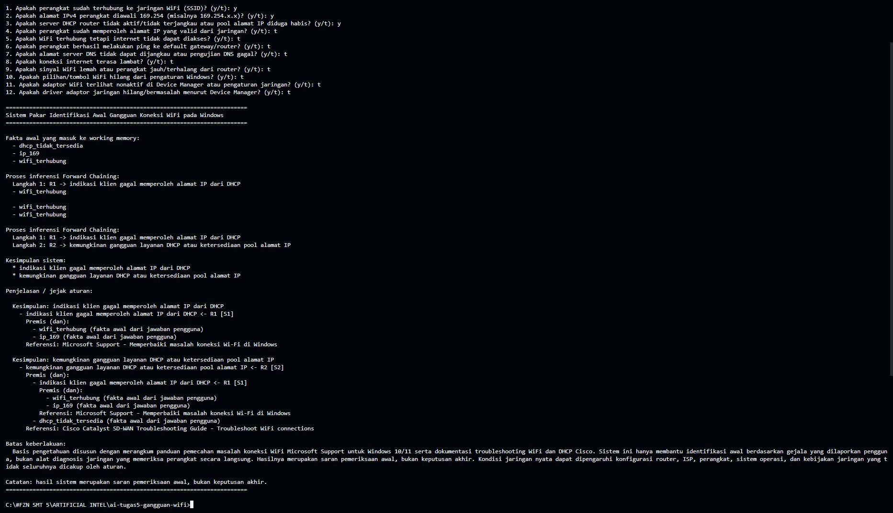
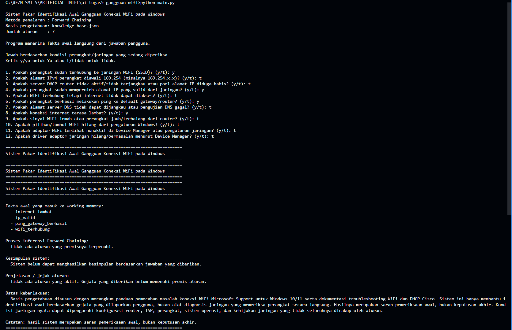
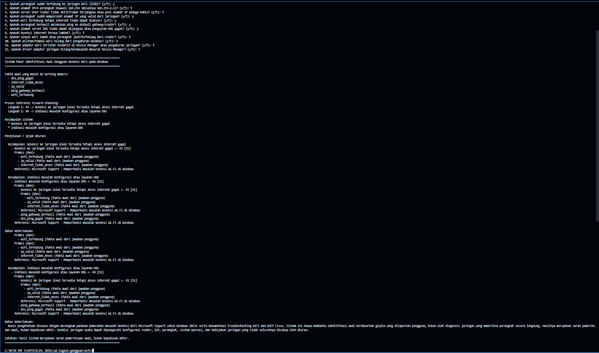

# Sistem Pakar Identifikasi Awal Gangguan Koneksi WiFi pada Windows

## 1. Identitas

- Nama: **FAUZAN HARI RAMDANI**
- NIM: **F1D02410047**
- Mata kuliah: Kecerdasan Buatan

## 2. Deskripsi sistem

Program ini dibuat untuk membantu mengenali beberapa kemungkinan masalah koneksi WiFi pada Windows. Pengguna menjawab pertanyaan tentang kondisi jaringan melalui terminal. Jawaban tersebut kemudian diproses menggunakan aturan yang disimpan di `knowledge_base.json`.

Semua fakta awal berasal dari jawaban pengguna. Jadi, program tidak langsung memberikan hasil dari kasus yang sudah disiapkan. Setelah semua pertanyaan dijawab, sistem mencocokkan fakta dengan aturan menggunakan metode Forward Chaining, lalu menampilkan kesimpulan beserta aturan yang digunakan.

## 3. Persyaratan dan cara menjalankan

- Python 3.9 atau lebih baru.
- Tidak membutuhkan library eksternal.

Buka terminal pada folder proyek, lalu jalankan:

```bash
python main.py
```

Jika perintah `python` tidak dikenali pada Windows, coba:

```bash
py main.py
```

## 4. Sumber pengetahuan

Untuk menyusun aturan pada sistem ini, saya menggunakan beberapa dokumentasi teknis berikut sebagai bahan referensi. Isi sumber dipahami dan diringkas kembali menjadi aturan IF-THEN yang sesuai dengan ruang lingkup program.

| ID  | Judul                                                           | Penerbit                                    | URL                                                                                                                                           | Diakses         |
| --- | --------------------------------------------------------------- | ------------------------------------------- | --------------------------------------------------------------------------------------------------------------------------------------------- | --------------- |
| S1  | Memperbaiki masalah koneksi Wi-Fi di Windows                    | Microsoft Support                           | https://support.microsoft.com/id-id/windows/experience/connectivity-networking/fix-wi-fi-connection-issues-in-windows                         | 9 November 2026 |
| S2  | Troubleshoot WiFi connections                                   | Cisco Catalyst SD-WAN Troubleshooting Guide | https://www.cisco.com/c/en/us/td/docs/routers/sdwan/troubleshooting/guide/troubleshooting-guide/troubleshooting-tools-methods.html            | 9 November 2026 |
| S3  | Troubleshoot DHCP Client Connectivity Issue on a Cisco 9800 WLC | Cisco Support                               | https://www.cisco.com/c/en/us/support/docs/wireless/catalyst-9800-80-wireless-controller/221973-troubleshoot-dhcp-client-connectivity-is.html | 9 November 2026 |

## 5. Tabel aturan IF-THEN

| Aturan | IF (premis)                                                                                       | Operator | THEN (kesimpulan)                                                  | Sumber |
| ------ | ------------------------------------------------------------------------------------------------- | -------- | ------------------------------------------------------------------ | ------ |
| R1     | WiFi terhubung; alamat IP diawali 169.254                                                         | AND      | Indikasi klien gagal memperoleh alamat IP dari DHCP                | S1     |
| R2     | Indikasi klien gagal memperoleh alamat IP dari DHCP; server DHCP tidak tersedia/pool diduga habis | AND      | Kemungkinan gangguan layanan DHCP atau ketersediaan pool alamat IP | S2     |
| R3     | WiFi terhubung; IP valid; internet tidak dapat diakses                                            | AND      | Koneksi ke jaringan lokal tersedia tetapi akses internet gagal     | S1     |
| R4     | Koneksi lokal tersedia tetapi internet gagal; ping gateway berhasil; pengujian DNS gagal          | AND      | Indikasi masalah konfigurasi atau layanan DNS                      | S1     |
| R5     | Internet lambat; sinyal WiFi lemah atau terhalang                                                 | AND      | Indikasi kualitas sinyal WiFi lemah atau terhalang                 | S1     |
| R6     | Opsi WiFi hilang; adaptor nonaktif                                                                | AND      | Adaptor WiFi kemungkinan dalam keadaan nonaktif                    | S1     |
| R7     | Adaptor WiFi kemungkinan nonaktif; driver bermasalah                                              | AND      | Perlu pemeriksaan atau pemasangan ulang driver adaptor jaringan    | S1     |

R1 dan R2 merupakan contoh rantai inferensi: kesimpulan R1 digunakan sebagai salah satu premis R2.

## 6. Metode inferensi

Metode yang digunakan adalah **Forward Chaining**. Sederhananya, proses dimulai dari fakta yang diberikan pengguna. Program lalu memeriksa apakah fakta tersebut cocok dengan bagian IF pada aturan. Jika cocok, bagian THEN menjadi kesimpulan baru dan ditambahkan ke working memory. Kesimpulan baru itu bisa digunakan lagi untuk memeriksa aturan berikutnya. Proses berhenti ketika tidak ada aturan lain yang cocok.

Alur:

1. Pengguna menjawab pertanyaan gejala.
2. Jawaban Ya dimasukkan sebagai fakta awal.
3. Sistem mencocokkan fakta dengan premis aturan di file JSON.
4. Kesimpulan dari aturan yang terpenuhi ditambahkan ke working memory.
5. Sistem mengulangi pencocokan hingga tidak ada aturan baru.
6. Sistem menampilkan kesimpulan dan jejak aturan.

## 7. Rencana dan dokumentasi pengujian interaktif

Saya menguji program dengan menjalankannya beberapa kali dan memasukkan jawaban secara langsung melalui terminal. Tiga pengujian berikut dipakai untuk melihat apakah sistem bisa memberikan kesimpulan saat syarat aturan terpenuhi, dan tidak memberikan kesimpulan saat gejalanya belum cukup. Kombinasi jawaban ini hanya menjadi panduan saat pengujian, bukan kasus yang tertanam di dalam program.

| Pengujian                      | Jawaban Ya yang dimasukkan secara manual                                                           | Hasil yang diharapkan                                 |
| ------------------------------ | -------------------------------------------------------------------------------------------------- | ----------------------------------------------------- |
| 1. Positif: indikasi DHCP      | WiFi terhubung; IP diawali 169.254; DHCP tidak tersedia/pool diduga habis                          | R1 dan R2 aktif; menghasilkan kesimpulan terkait DHCP |
| 2. Negatif: gejala belum cukup | Hanya internet lambat; gejala lain dijawab Tidak                                                   | Tidak ada aturan aktif dan tidak ada kesimpulan       |
| 3. Positif: indikasi DNS       | WiFi terhubung; IP valid; internet tidak dapat diakses; ping gateway berhasil; pengujian DNS gagal | R3 dan R4 aktif; menghasilkan indikasi masalah DNS    |

### Screenshot hasil pengujian

Setelah menjalankan `python main.py` dan menjawab semua pertanyaan secara manual untuk setiap pengujian, simpan screenshot terminal berikut.

**Pengujian 1 - Indikasi DHCP**



**Pengujian 2 - Kasus negatif**



**Pengujian 3 - Indikasi DNS**



Screenshot di atas diambil dari proses pengujian melalui terminal. Bagian yang ditampilkan meliputi jawaban yang dimasukkan, fakta yang terbentuk, proses inferensi, dan hasil akhir.

## 8. Batas keberlakuan sistem

Aturan dalam program ini masih terbatas pada beberapa gejala, seperti perangkat gagal memperoleh alamat IP, kemungkinan masalah DHCP, internet tidak bisa diakses meskipun WiFi tersambung, indikasi masalah DNS, sinyal WiFi lemah, serta adaptor atau driver WiFi. Program belum memeriksa kondisi jaringan secara langsung. Hasilnya bergantung pada jawaban pengguna, sehingga kesimpulan yang diberikan hanya menjadi petunjuk pemeriksaan awal dan bukan diagnosis yang pasti.

## 9. Penggunaan alat bantu AI

Dalam pengerjaan tugas ini, saya tetap terlibat pada proses penentuan topik dan batas masalah, memilih gejala yang akan dibahas, mempelajari referensi, menentukan kombinasi jawaban untuk pengujian, menjalankan program, memeriksa hasil inferensi, serta mengambil dan menyusun screenshot. Saya juga meninjau kembali aturan dan hasil program agar sesuai dengan tujuan tugas.

ChatGPT saya gunakan sebagai alat bantu untuk mendapatkan gambaran awal struktur program, membantu menyusun kerangka kode Python dan format basis pengetahuan JSON, serta memberi masukan saat merapikan penjelasan dan README. Saran dari AI tidak langsung digunakan begitu saja, tetapi saya periksa dan sesuaikan dengan topik, aturan, dan hasil pengujian.
